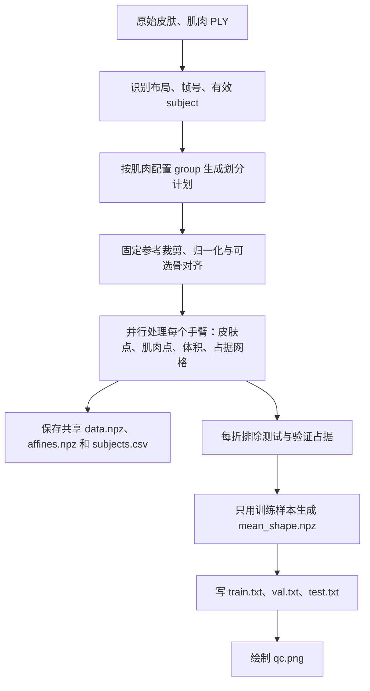

# prepare_cactus.py 逐行中文解释

对应文件：`tools/prepare_cactus.py`。本说明是对代码的解释，不是要求执行文件中的示例命令；代码和说明字符串里的老师路径不是你在 Cetus 上必须使用的路径。原程序没有修改。

## 先理解整个流程



本脚本不包含 PyTorch 模型训练、反向传播、训练 epoch 或测试预测。这里的“目标肌肉”是监督训练所需的真实标签，不是模型估计结果。后续 `main.py` 才训练模型。

### 最容易混淆的名词

| 变量/术语 | 含义 | 你的数据示例 |
|---|---|---|
| `args.frame` | Houdini 导出的帧号 | 160 或 220 |
| `Frame` / `frame` 对象 | 固定空间参考：中心、尺度、裁剪树、体素网格、骨对齐信息 | 不是动画帧号本身 |
| `subject` | 一个配置加一个 T 变体的皮肤样本 | `BB_0_TRL_0.6_TRM_0.6_TRLN_0.6_T_1` |
| `group` | 肌肉参数配置，去掉末尾 T 参数 | `BB_0_TRL_0.6_TRM_0.6_TRLN_0.6` |
| `sid` / arm sample | subject 加左/右臂后缀 | 上述 subject 加 `_R` 或 `_L` |
| `fold` | 一次训练/验证/测试划分 | `fold_00` |
| `verts` / `faces` | 网格顶点 N×3 / 三角面顶点索引 F×3 | faces 不是坐标，而是引用 verts 的整数编号 |
| `occupancy` | 肌肉内部体素的布尔标记 | 每个网格位置是 0 或 1 |
| `template` | 从训练样本占据频率提取的代表性肌肉形状 | 不是原始网格对应顶点的坐标平均 |

### 对应你已经完成的 frame 160 实验

81 个肌肉配置组 × 每组 3 个 T 变体 × 左右 2 臂 = 486 个手臂样本。留一组时，测试 1 组（6 臂）；剩余 80 组的 10% 为验证 8 组（48 臂）；训练 72 组（432 臂）。折数取决于有效数据配置组，不是固定 49。每折一个不同测试组；同一样本在其他折可以是训练或验证样本。

你当前默认配置：`--align none`、`--n_body 16384`、`--n_organ 4096`、`--crop_mm 100`、`--leave_out 1`、`--val_frac 0.1`。PBS 脚本指定 `--workers 4`，覆盖本文件的默认值 8。

## 数据文件里面究竟是什么

| 文件 | 关键内容 | 用途 |
|---|---|---|
| `data.npz` | `sid__input_points`：16384×3；`sid__肌肉名`：各 4096×3 | 共享输入皮肤点及监督目标肌肉点 |
| `affines.npz` | 每个 sid 对应 4×4 矩阵 | 兼容旧评估函数，把归一化点恢复成毫米 |
| `subjects.csv` | 参数、臂侧、group、裁剪顶点数、中心偏移、真实网格体积等 | 样本说明和检查；不是每折完整角色名单 |
| `labels/label_organs_arm4.json` | 编号字符串到肌肉名 | 各点标签的语义 |
| `folds/fold_XX/train.txt`、`val.txt`、`test.txt` | 每行一个 sid | 此折真正的训练/验证/测试归属 |
| `folds/fold_XX/mean_shape.npz` | 16384×3 模板点、标签、闭合模板网格、近邻插值信息 | 模型初始模板及后续预测体积估计 |
| `qc.png` | 一个训练样本和第一折模板的二维投影 | 检查裁剪、尺度、肌肉位置，不是训练结果 |

## 数学与实现重点

### 1. 面积均匀采样并不是随机抽顶点

85 行导入的 `sample_surface` 实际实现位于 `prepare_totalseg_mri.py`：先按三角面面积比例选择面，再在三角形内部均匀取点。这样大面得到更多采样，不会因为某处网格顶点密度高就被过度采样。输出点通常不等于原网格顶点。

### 2. 统一归一化

设点为 p、参考中心为 c、参考尺度为 s：`p_normalised=(p-c)/s`。三个方向共用同一个 s，避免把肌肉沿不同轴分别拉伸。归一化参考裁剪的范围大致位于 [-1,1]；函数没有截断，也不保证其他样本全在该区间。

`eval_affine` 为旧的 MRI 评估接口构造兼容矩阵：旧接口先从 p 得到虚拟体素坐标 v，本脚本矩阵再把 v 变成 `c+s*p`，可选逆骨对齐，最后转毫米。这里没有把 Houdini 数据真的重采样成 MRI 网格。

### 3. 闭合网格体积

`mesh_volume` 累加每个三角面和原点形成的有符号四面体体积，整体取绝对值。它要求闭合且面朝向一致；整体取 abs 不能修复局部错误面朝向。默认长度单位米，乘 1e6 转毫升。

### 4. 模板不是平均顶点

每个训练肌肉网格先变成占据网格 O，体素间距默认 1.5 毫米。把训练样本占据相加、除以训练臂数，得到某位置被肌肉占据的频率 P；轻微平滑 P，按训练平均体素数选阈值，保留最大连通分量，再 marching cubes 提取表面，最后采样模板点。

代码注释说“恰好选 k 个体素”，但实际 `>=阈值` 可能遇到并列值，最大连通分量又可能删除部分体素，因此不是严格恰好 k。这意味着模板目标体积是近似保持。

### 5. 每折模板如何避免混入测试和验证样本

交叉验证预先为所有样本体素化，只是提高复用效率。每折的 `write_split` 会执行“总占据 − 该折测试占据 − 该折验证占据”，最终模板只依赖训练组。不能因为预先处理了全部样本，就认定模板把测试肌肉平均进去了。

需要区分模板和裁剪参考：模板逐折独立；裁剪中心、尺度、网格边界使用一个全局参考 subject。该参考在某折可能属于测试组，其肌肉参与固定空间参考构建。代码自己在模块说明中承认了这一点，因此“训练模板没有测试数据”不等于“整个预处理完全不接触任何测试信息”。

### 6. 模板网格为什么记录近邻和权重

模型输出模板采样点的位移；点云本身没有闭合三角面，不能直接套用闭合网格体积公式。因此保存每个模板网格顶点最近的 8 个模板采样点和归一化逆距离权重，把预测位移插值到闭合网格，供后续 `volume_eval.py` 估计预测体积。

## 逐行说明

以下按原文件行号列出全部 629 行，空行也标明。跨行表达式在各行说明中注明其连续关系；三引号中的英文是模块说明，不会执行。

### L1 起：模块说明与使用示例

**L1**

```python
"""Build DeformingPointTransformer inputs from the Houdini cactus-pose arm simulations.
```

开始模块说明字符串：本脚本把 Houdini 手臂仿真转换成模型输入；不是训练程序。

**L2**

```python

```

空行：分隔说明或代码块，不执行任何操作。

**L3**

```python
Two export layouts under --data are recognised automatically:
```

说明会根据数据目录自动识别两种导出布局。

**L4**

```python

```

空行：分隔说明或代码块，不执行任何操作。

**L5**

```python
  "separated" (current export, /data/aalempij/data/datasets_cactus_pose; frames 160, 220):
```

介绍 separated 布局及老师机器上的示例路径，示例帧为 160、220；不是你的默认存储要求。

**L6**

```python
    final skin/<subject>/final_skin.<frame:05d>.ply
```

规定皮肤 PLY 的路径模板；frame:05d 表示帧号补足五位，例如 00160。

**L7**

```python
    separated muscles/<Muscle>/<group>/<Muscle>.<frame:05d>.ply   (one closed mesh per muscle, both arms)
```

规定分离肌肉的路径；一个文件包含同一块肌肉的左右臂闭合网格。

**L8**

```python
    bones/bones.<frame:05d>.ply
```

规定该布局的骨骼文件路径。

**L9**

```python
  "entire" (first export, datasets_cactus_poses; frames 45, 56):
```

介绍早期 entire 布局，示例帧为 45、56。

**L10**

```python
    final skins for 45th and 56th frames/<subject>/final_skin.<frame:05d>.ply
```

规定早期皮肤文件路径。

**L11**

```python
    entire muscles for 45th and 56th frames/<subject>/entire_muscles.<frame:05d>.ply  (muscles by 'piece')
```

规定整块肌肉网格路径，使用顶点 piece 属性区分不同肌肉。

**L12**

```python
    bones for 45th and 56th frames/bones/v1/bones_v1.<frame:04d>.ply
```

规定早期骨骼路径；帧号补足四位。

**L13**

```python

```

空行：分隔说明或代码块，不执行任何操作。

**L14**

```python
Subject folder names carry the simulation parameters, e.g. BB_0.6_TRL_-0.6_TRM_0_TRLN_-0.6_T_1.25;
```

说明 subject 文件夹名编码 BB、TRL、TRM、TRLN、T 参数。

**L15**

```python
they are parsed into subjects.csv. In the separated layout the muscles depend only on BB/TRL/TRM/TRLN:
```

说明这些参数写入 subjects.csv；当前分离布局的肌肉由四个肌肉参数决定。

**L16**

```python
the muscle folder (the "group") is the subject name without _T_<value>, and the skins of one group
```

说明 group 名去掉 subject 末尾的 _T_数值。

**L17**

```python
(different T) share the same muscles. Splits and folds are therefore made by GROUP: every skin
```

同一 group 的不同 T 皮肤共享肌肉；所以按 group 划分。

**L18**

```python
variant and both arms of a group are on the same side, so a test muscle shape is never seen in
```

同组所有皮肤变体和左右臂都留在同一数据划分中。

**L19**

```python
training. Skin and muscle meshes may differ in topology per subject.
```

目的是避免同一测试肌肉配置进入训练；允许不同 subject 网格拓扑不同。

**L20**

```python

```

空行：分隔说明或代码块，不执行任何操作。

**L21**

```python
Per arm sample:
```

开始说明每个手臂样本的构成。

**L22**

```python
  input   skin within --crop_mm of a fixed reference position of the target muscles
```

输入皮肤取自固定参考肌肉附近的空间范围。

**L23**

```python
          (taken once from --reference, so the crop never depends on the sample's own
```

参考位置统一取自 --reference，不逐样本使用其真实肌肉决定裁剪区域。

**L24**

```python
          muscles), --n_body points sampled uniformly by area
```

按网格表面积均匀采样 --n_body 个皮肤点。

**L25**

```python
  target  each target muscle (--muscles / --pieces), --n_organ points sampled uniformly by area
```

每块目标肌肉按表面积均匀采样 --n_organ 个目标点。

**L26**

```python
The left arm is mirrored (x -> -x) onto the right, so --arms both gives two samples per
```

左臂通过 x 取反镜像到右臂方向；both 时一个 subject 得到两臂样本。

**L27**

```python
subject; both arms of a subject always go to the same split.
```

同一 subject 的左右臂不会分别进入训练和测试。

**L28**

```python

```

空行：分隔说明或代码块，不执行任何操作。

**L29**

```python
All samples share one isotropic normalisation to [-1, 1] (centre and scale of the reference
```

所有样本共用参考裁剪得到的中心和单一尺度；约映射至 [-1,1]，不是逐点截断保证范围。

**L30**

```python
crop). affines.npz holds, per sample, a 4x4 that util/evaluation_functions.convert_to_mm turns
```

affines.npz 保存每个样本的 4×4 坐标变换矩阵。

**L31**

```python
into mm: that function assumes the MRI voxel grid GRID_SHAPE, so the affine is composed to
```

旧评估函数先按 MRI 网格把归一化点转换成虚拟体素位置。

**L32**

```python
undo its grid mapping and apply ours instead.
```

因此这里构造兼容该旧转换的矩阵，把位置正确还原成毫米。

**L33**

```python

```

空行：分隔说明或代码块，不执行任何操作。

**L34**

```python
The template (mean_shape.npz) is built from the training samples only: per muscle, the voxels
```

模板只用当前折训练样本构造，不用验证或测试样本。

**L35**

```python
most often occupied, keeping as many as the mean muscle volume.
```

通过体素占据频率和训练样本平均体积提取代表性形状，并非直接平均对应顶点。

**L36**

```python

```

空行：分隔说明或代码块，不执行任何操作。

**L37**

```python
Bone alignment (--align bone): each arm is first mapped onto the reference subject's humerus by
```

说明可选骨骼对齐功能。

**L38**

```python
the least-squares similarity transform (rotation, translation, uniform scale) between
```

用对应肱骨顶点的最小二乘相似变换，包括旋转、平移和统一缩放。

**L39**

```python
corresponding humerus vertices, so differences in bone size / placement are removed before
```

先减少骨骼尺寸、位置差异，再进行裁剪。

**L40**

```python
cropping; the learned task is then muscle shape relative to the skeleton. The humerus is found
```

此模式学习相对于骨骼的肌肉形状；自动识别肱骨。

**L41**

```python
automatically (the bone component closest to the target muscles, per arm) and bone meshes must
```

根据骨骼连通分量靠近目标肌肉的程度识别肱骨。

**L42**

```python
share one topology. Evaluation mm stay in each subject's own space (the per-sample affine undoes
```

骨骼必须有对应顶点拓扑；评估时逆变换回样本自身坐标。

**L43**

```python
the alignment). --bone_file may contain {subject} and {frame} for per-subject skeletons.
```

骨骼路径可以带 subject、frame 占位符以支持不同样本文件。

**L44**

```python

```

空行：分隔说明或代码块，不执行任何操作。

**L45**

```python
Validation (--val_frac F): in every split (each fold, or the single split) a fraction F of the
```

介绍每折或单次划分中的验证集。

**L46**

```python
non-test groups is held out as val.txt; main.py then picks its checkpoint (and early-stops) on the
```

验证组从非测试组抽取，供 main.py 选择模型和提前停止。

**L47**

```python
validation loss. Train / validation / test never share a group, and the template is built from the
```

三个集合在 group 层面不重叠；模板仅使用训练组。

**L48**

```python
training groups only. Leave-one-group-out with --val_frac 0.1: test 1 group, validation 5, train 43.
```

这里的 1 测试、5 验证、43 训练是老师 49 组的示例，不是写死数量；你有 81 组。

**L49**

```python

```

空行：分隔说明或代码块，不执行任何操作。

**L50**

```python
Leave-N-out (--leave_out N): groups are shuffled and split into folds of N groups (all skins and
```

说明 leave_out=N：随机打乱 group，每折留出最多 N 个组。

**L51**

```python
both arms of a group stay together; in the old layout a group is one subject). Each fold gets folds/fold_XX/{train.txt, test.txt, mean_shape.npz},
```

同组所有皮肤和左右臂一并留出；早期布局一个 subject 就是一组。

**L52**

```python
with the template built from that fold's training subjects; data.npz, affines.npz and labels are
```

每折独立构造训练模板，点云和坐标矩阵可以共用。

**L53**

```python
shared. Run all folds with tools/run_folds.py. The crop / normalisation reference is one fixed
```

多折训练由另一脚本 run_folds.py 完成；裁剪参考在各折之间固定。

**L54**

```python
subject for all folds (--reference, default the first subject); in the fold where it is a test
```

交叉验证默认使用排序后的第一个 subject 作为参考，可能在某折成为测试组。

**L55**

```python
subject its muscles only set where the 10 cm crop boundary lies.
```

说明参考测试 subject 的肌肉用于设置裁剪范围：因此不能声称整个预处理完全没有接触任何测试信息。

**L56**

```python

```

空行：分隔说明或代码块，不执行任何操作。

**L57**

```python
Outputs in --out (same formats as prepare_totalseg_mri.py, for main.py):
```

开始列出输出格式，格式兼容 main.py。

**L58**

```python
  data.npz, mean_shape.npz, affines.npz, labels/label_organs_<label_set>.json,
```

共享点云、模板、仿射矩阵、标签 JSON。

**L59**

```python
  train.txt, test.txt, subjects.csv, qc.png          (single split)
```

单次划分还有训练/测试名单、样本报告、质检图；开启验证时也有 val.txt。

**L60**

```python
  data.npz, affines.npz, labels/, folds/fold_XX/..., subjects.csv, qc.png   (--leave_out N)
```

多折模式把每折名单和模板放在 folds/ 内。

**L61**

```python

```

空行：分隔说明或代码块，不执行任何操作。

**L62**

```python
Usage:
```

下面是使用示例，不会在导入文件时执行。

**L63**

```python
  python tools/prepare_cactus.py --out data/cactus160                      # single split, frame 160
```

单次训练/测试划分的命令示例。

**L64**

```python
  python tools/prepare_cactus.py --out data/cactus160_loo --leave_out 1    # leave-one-group-out (49 folds)
```

留一组交叉验证示例；49 折只是示例数据规模。

**L65**

```python
  python tools/prepare_cactus.py --out data/cactus220_loo --leave_out 1 --frame 220
```

指定 frame=220 的命令示例。

**L66**

```python
  python tools/prepare_cactus.py --data /data/aalempij/data/datasets_cactus_poses --out data/cactus45  # old export
```

指定早期布局数据根目录的示例。

**L67**

```python
"""
```

关闭模块说明字符串。

### L68 起：导入与常量

**L68**

```python
import argparse
```

导入 argparse，用于解析命令行参数。

**L69**

```python
import csv
```

导入 csv；此文件本身未直接使用它，CSV 写出交给导入的 write_csv。

**L70**

```python
import json
```

导入 json，用于保存标签编号与肌肉名称的映射。

**L71**

```python
import os
```

导入 os，用于拼路径、检查文件、创建目录。

**L72**

```python
import re
```

导入 re，使用正则表达式处理组名和参数。

**L73**

```python
import sys
```

导入 sys，用于修改模块搜索路径。

**L74**

```python
import zlib
```

导入 zlib，用 CRC32 从样本名生成稳定的随机种子组成部分。

**L75**

```python
from multiprocessing import Pool
```

导入多进程池 Pool，使多个 CPU 进程并行处理样本。

**L76**

```python

```

空行：分隔说明或代码块，不执行任何操作。

**L77**

```python
import numpy as np
```

导入 NumPy，简写 np，负责数组、矩阵和 npz 文件。

**L78**

```python
from scipy import ndimage
```

导入 ndimage，用于高斯平滑等体素处理。

**L79**

```python
from scipy.sparse import coo_matrix
```

导入 COO 稀疏矩阵，用于建立骨骼网格邻接图。

**L80**

```python
from scipy.sparse.csgraph import connected_components
```

导入图连通分量算法，用于分离不同骨骼。

**L81**

```python
from scipy.spatial import cKDTree
```

导入 KD 树，用于快速最近邻和距离查询。

**L82**

```python
from skimage import measure
```

导入 skimage.measure，用于 marching cubes 从体素提取三角网格。

**L83**

```python

```

空行：分隔说明或代码块，不执行任何操作。

**L84**

```python
sys.path.insert(0, os.path.dirname(os.path.abspath(__file__)))
```

将当前脚本目录放在模块搜索路径首位，确保能导入同目录工具。

**L85**

```python
from prepare_totalseg_mri import GRID_SHAPE, largest_cc, sample_surface, write_csv  # noqa: E402
```

复用 MRI 脚本中的网格尺寸、最大连通分量、表面采样和 CSV 写出函数；不会因此执行 MRI 的 main。noqa 是静态检查豁免标记。

**L86**

```python

```

空行：分隔说明或代码块，不执行任何操作。

**L87**

```python
DATA = "/data/aalempij/data/datasets_cactus_pose"
```

默认数据路径是老师机器的路径；Cetus 必须通过 --data 提供实际位置。

**L88**

```python
LAYOUTS = {
```

建立布局字典，描述不同导出文件路径和默认帧。

**L89**

```python
    "separated": {"skin": "final skin/{subject}/final_skin.{frame:05d}.ply",
```

separated 布局的皮肤路径字符串。

**L90**

```python
                  "muscle": "separated muscles/{folder}/{group}/{folder}.{frame:05d}.ply",
```

separated 布局的肌肉路径字符串。

**L91**

```python
                  "bone": "bones/bones.{frame:05d}.ply", "frame": 160},
```

separated 布局的骨骼路径和默认帧 160。

**L92**

```python
    "entire": {"skin": "final skins for 45th and 56th frames/{subject}/final_skin.{frame:05d}.ply",
```

entire 布局的皮肤路径字符串。

**L93**

```python
               "muscle": "entire muscles for 45th and 56th frames/{subject}/entire_muscles.{frame:05d}.ply",
```

entire 布局的肌肉路径字符串。

**L94**

```python
               "bone": "bones for 45th and 56th frames/bones/v1/bones_v1.{frame:04d}.ply", "frame": 45},
```

entire 布局的骨骼路径和默认帧 45。

**L95**

```python
}
```

结束布局字典。

**L96**

```python
# separated layout: name:folder of each target muscle under "separated muscles"
```

注释：下面定义模型内部肌肉名与导出文件夹名的对应关系。

**L97**

```python
DEFAULT_MUSCLES = ("biceps_brachii:bicepsBrachialis,triceps_lateral:tricepsLateralis,"
```

指定 biceps_brachii、triceps_lateral 对应的文件夹；括号内相邻字符串会自动连接。

**L98**

```python
                   "triceps_medial:tricepsMedialis,triceps_long:tricepsLongus")
```

继续指定 triceps_medial、triceps_long 对应文件夹。

**L99**

```python
# entire layout: name:right_piece:left_piece in the 'piece' attribute of entire_muscles (checked on
```

注释：旧布局按 piece 数值选左右肌肉。

**L100**

```python
# the v1 export: these pieces change most when BB / TRL / TRM / TRLN are varied)
```

注释：piece 编号根据 v1 导出检查得到，不一定适用其他导出。

**L101**

```python
DEFAULT_PIECES = "biceps_brachii:5:104,triceps_lateral:94:193,triceps_medial:96:195,triceps_long:95:194"
```

定义四块肌肉的右臂和左臂 piece 编号。

**L102**

```python
BONE_FILE = LAYOUTS["entire"]["bone"]  # kept for older imports
```

保留旧布局的骨文件常量，兼容其他脚本的导入。

**L103**

```python
PITCH = 0.0015  # voxel size (m) for the mean-shape occupancy grid
```

模板体素间距 0.0015 米，即 1.5 毫米；此常量假定网格以米为单位。

**L104**

```python

```

空行：分隔说明或代码块，不执行任何操作。

**L105**

```python

```

空行：分隔说明或代码块，不执行任何操作。

**L106**

```python
# ----------------------------------------------------------------------------- io
```

注释分隔线：下面是输入输出相关函数。

### L107 起：读取 PLY 与发现样本

**L107**

```python
def read_ply(path, props=("x", "y", "z")):
```

定义 read_ply；默认只返回 x、y、z 顶点属性。

**L108**

```python
    """Binary PLY -> (dict of vertex properties, (F,3) triangles). Polygons are fan-triangulated."""
```

函数说明：读取二进制 PLY，输出属性字典和 F×3 三角形索引；多边形扇形三角化。

**L109**

```python
    with open(path, "rb") as f:
```

以二进制只读方式打开文件，with 结束时自动关闭。

**L110**

```python
        fields, nv, nf, fmt = [], 0, 0, None
```

初始化顶点属性列表、顶点数、面数和端序。

**L111**

```python
        while True:
```

循环读取 PLY 文本头。

**L112**

```python
            line = f.readline().decode("ascii").strip()
```

读一行、按 ASCII 解码、去除首尾空白。

**L113**

```python
            if line.startswith("format"):
```

如果该行声明 format，则解析端序。

**L114**

```python
                fmt = ">" if "big_endian" in line else "<"
```

big_endian 使用 >，否则用 <；这里只判断端序，没有显式拒绝 ASCII PLY。

**L115**

```python
            elif line.startswith("element vertex"):
```

检测顶点数量声明。

**L116**

```python
                nv = int(line.split()[-1])
```

取该行最后一项作为整数顶点数。

**L117**

```python
            elif line.startswith("element face"):
```

检测面数量声明。

**L118**

```python
                nf = int(line.split()[-1])
```

取该行最后一项作为整数面数。

**L119**

```python
            elif line.startswith("property") and "list" not in line:
```

处理非 list 类型的属性声明；代码假定这些标量属性对应顶点，不跟踪当前 element。

**L120**

```python
                _, t, name = line.split()
```

拆成 property、类型、属性名三个字段。

**L121**

```python
                fields.append((name, fmt + {"float": "f4", "int": "i4", "uchar": "u1", "double": "f8"}[t]))
```

映射 float/int/uchar/double 到 NumPy 存储类型并加上端序；其他类型未支持。

**L122**

```python
            elif line == "end_header":
```

发现 end_header，结束头部解析。

**L123**

```python
                break
```

跳出读取头部循环。

**L124**

```python
        vdt = np.dtype(fields)
```

创建结构化数组 dtype，包含各个顶点属性的字段。

**L125**

```python
        v = np.frombuffer(f.read(nv * vdt.itemsize), vdt)
```

按 顶点数×每顶点字节数 读取顶点块，并把字节解释成结构化数组。

**L126**

```python
        buf = f.read()
```

把文件剩余部分读为面数据缓冲区。

**L127**

```python
    tri_dt = np.dtype([("n", "u1"), ("i", fmt + "i4", (3,))])
```

定义常见三角面格式：一个 uchar 顶点数，再跟三个 int32 索引。

**L128**

```python
    if len(buf) == nf * tri_dt.itemsize and (np.frombuffer(buf, tri_dt, nf)["n"] == 3).all():
```

若缓冲区长度正确且所有面顶点数均为 3，使用快速三角形解析路径。

**L129**

```python
        faces = np.frombuffer(buf, tri_dt, nf)["i"].astype(np.int64)
```

直接提取所有面索引，并转为 int64。

**L130**

```python
    else:
```

否则走逐面解析和多边形三角化路径。

**L131**

```python
        faces, pos = [], 0
```

初始化三角面列表和当前字节偏移。

**L132**

```python
        for _ in range(nf):
```

逐个处理 nf 个面。

**L133**

```python
            n = buf[pos]
```

读取当前面包含的顶点数量，假定数量以单字节存储。

**L134**

```python
            idx = np.frombuffer(buf, fmt + "i4", n, pos + 1)
```

读取随后 n 个 int32 顶点索引；pos+1 跳过数量字节。

**L135**

```python
            pos += 1 + 4 * n
```

更新偏移：数量占 1 字节，每索引占 4 字节。

**L136**

```python
            faces += [(idx[0], idx[j], idx[j + 1]) for j in range(1, n - 1)]
```

以第一个顶点为中心，把多边形拆成 (0,j,j+1) 三角形；对任意凹多边形不保证正确几何分解。

**L137**

```python
        faces = np.array(faces, np.int64)
```

把三角形列表转换成 int64 数组。

**L138**

```python
    return {p: np.asarray(v[p]) for p in props if p in v.dtype.names}, faces
```

返回请求且确实存在的顶点属性及面索引；缺失请求属性会被跳过，而非立即报错。

**L139**

```python

```

空行：分隔说明或代码块，不执行任何操作。

**L140**

```python

```

空行：分隔说明或代码块，不执行任何操作。

**L141**

```python
def xyz(v):
```

定义 xyz，将属性字典合并成坐标矩阵。

**L142**

```python
    return np.c_[v["x"], v["y"], v["z"]].astype(np.float64)
```

按列连接 x/y/z，得到 N×3 float64 数组。

**L143**

```python

```

空行：分隔说明或代码块，不执行任何操作。

**L144**

```python

```

空行：分隔说明或代码块，不执行任何操作。

**L145**

```python
def detect_layout(data):
```

定义自动布局识别函数。

**L146**

```python
    return "separated" if os.path.isdir(os.path.join(data, "separated muscles")) else "entire"
```

存在 separated muscles 目录则判定 separated，否则判定 entire；不是全面验证布局有效性。

**L147**

```python

```

空行：分隔说明或代码块，不执行任何操作。

**L148**

```python

```

空行：分隔说明或代码块，不执行任何操作。

**L149**

```python
def group_of(subject, layout):
```

定义 subject 到肌肉配置组的映射。

**L150**

```python
    """Muscle configuration of a subject: the name without _T_<value> (separated layout)."""
```

说明 separated 的 group 去掉末尾 T 参数。

**L151**

```python
    return re.sub(r"_T_[^_]+$", "", subject) if layout == "separated" else subject
```

正则删除末尾 _T_非下划线字符串；旧布局不删，直接用完整 subject。

**L152**

```python

```

空行：分隔说明或代码块，不执行任何操作。

**L153**

```python

```

空行：分隔说明或代码块，不执行任何操作。

**L154**

```python
def parse_muscles(spec, layout):
```

定义肌肉配置字符串解析函数。

**L155**

```python
    """[(name, folder)] (separated) or [(name, right_piece, left_piece)] (entire)."""
```

说明两种布局返回的元组结构不同。

**L156**

```python
    if layout == "separated":
```

分离肌肉布局的分支。

**L157**

```python
        return [tuple(m.split(":")) for m in spec.split(",")]
```

按逗号拆肌肉项，再按冒号拆名称和目录；返回元组列表。

**L158**

```python
    return [(n, int(r), int(l)) for n, r, l in (p.split(":") for p in spec.split(","))]
```

旧布局把每项拆成名称、右 piece、左 piece，并将编号转成整数。

**L159**

```python

```

空行：分隔说明或代码块，不执行任何操作。

**L160**

```python

```

空行：分隔说明或代码块，不执行任何操作。

**L161**

```python
def find_subjects(data, frame, layout, muscles):
```

定义发现完整 subject 的函数。

**L162**

```python
    """[{subject, group, skin, muscles}] with every file present; muscles is a path per muscle name
```

函数说明：返回包含 subject、group、皮肤和肌肉路径的字典列表。

**L163**

```python
    (separated) or the path of entire_muscles (entire)."""
```

说明肌肉路径在 separated 下是字典，在 entire 下是单文件字符串。

**L164**

```python
    lay = LAYOUTS[layout]
```

取当前布局路径规则。

**L165**

```python
    skin_root = os.path.join(data, lay["skin"].split("/")[0])
```

提取皮肤路径的第一层目录，并连接数据根目录。

**L166**

```python
    subs = []
```

初始化有效 subject 列表。

**L167**

```python
    for s in sorted(os.listdir(skin_root)):
```

按名称排序遍历皮肤根目录的所有条目。

**L168**

```python
        g = group_of(s, layout)
```

从条目名得到 group。

**L169**

```python
        skin = os.path.join(data, lay["skin"].format(subject=s, frame=frame))
```

代入 subject 和 frame，生成皮肤文件路径。

**L170**

```python
        if layout == "separated":
```

分离肌肉布局分支。

**L171**

```python
            musc = {m[0]: os.path.join(data, lay["muscle"].format(folder=m[1], group=g, frame=frame)) for m in muscles}
```

为每块肌肉构造文件路径，字典键为模型使用的肌肉名。

**L172**

```python
            ok = all(map(os.path.isfile, musc.values()))
```

检查所有目标肌肉文件是否都存在。

**L173**

```python
        else:
```

旧布局分支。

**L174**

```python
            musc = os.path.join(data, lay["muscle"].format(subject=s, frame=frame))
```

生成整块肌肉网格路径。

**L175**

```python
            ok = os.path.isfile(musc)
```

检查该肌肉文件是否存在。

**L176**

```python
        if os.path.isfile(skin) and ok:
```

只有皮肤与所有肌肉文件都存在时才纳入样本。

**L177**

```python
            subs.append({"subject": s, "group": g, "skin": skin, "muscles": musc})
```

保存 subject、group、皮肤和肌肉路径；缺文件的条目会被静默跳过。

**L178**

```python
    return subs
```

返回有效 subject 列表。

**L179**

```python

```

空行：分隔说明或代码块，不执行任何操作。

**L180**

```python

```

空行：分隔说明或代码块，不执行任何操作。

### L181 起：读取肌肉与解析参数

**L181**

```python
def load_muscles(sub, arm, layout, muscles):
```

定义读取某一侧手臂肌肉网格的函数。

**L182**

```python
    """{name: (verts, faces)} of one arm in the right-arm frame (left arm mirrored, x -> -x).
```

说明输出为 name→(顶点,面)；左臂镜像到右臂坐标方向。

**L183**

```python
    Separated meshes hold both arms: the right arm is the part at x > 0."""
```

说明当前布局一个网格含双臂，按 x>0 判定右侧。

**L184**

```python
    out = {}
```

初始化肌肉输出字典。

**L185**

```python
    if layout == "separated":
```

分离肌肉布局分支。

**L186**

```python
        for name, _ in muscles:
```

遍历肌肉名称，目录字段此处不使用，用 _ 接收。

**L187**

```python
            v, f = read_ply(sub["muscles"][name])
```

读取该肌肉 PLY 的顶点属性和面索引。

**L188**

```python
            v = xyz(v)
```

将顶点属性转换成 N×3 坐标。

**L189**

```python
            side = v[f].mean(1)[:, 0] > 0
```

计算每个三角面重心的 x，形成 x>0 的右臂布尔标记。

**L190**

```python
            f = f[side if arm == "R" else ~side]
```

右臂保留标记为真的面；左臂保留其补集，包括重心 x=0 的面。

**L191**

```python
            if not len(f):
```

检查所选一侧是否有面。

**L192**

```python
                raise ValueError(f"{sub['subject']}: no {name} faces on the {arm} arm")
```

没有面则报错，防止生成空肌肉样本。

**L193**

```python
            out[name] = (v if arm == "R" else mirror(v), f)
```

右臂使用原顶点，左臂镜像顶点；面索引不重排，未被面引用的顶点仍留在数组。

**L194**

```python
    else:
```

旧整块肌肉布局分支。

**L195**

```python
        mv, mf = read_ply(sub["muscles"], props=("x", "y", "z", "piece"))
```

读取坐标和 piece 顶点属性。

**L196**

```python
        v, piece = xyz(mv), np.asarray(mv["piece"])
```

提取坐标与 piece 数组。

**L197**

```python
        v = v if arm == "R" else mirror(v)
```

左臂坐标镜像，右臂保持。

**L198**

```python
        for name, right, left in muscles:
```

遍历每块肌肉及左右 piece 编号。

**L199**

```python
            out[name] = organ_points(v, piece, mf, right if arm == "R" else left)
```

按当前臂选择 piece，通过 organ_points 提取目标肌肉的面。

**L200**

```python
    return out
```

返回肌肉网格字典。

**L201**

```python

```

空行：分隔说明或代码块，不执行任何操作。

**L202**

```python

```

空行：分隔说明或代码块，不执行任何操作。

**L203**

```python
def parse_params(name):
```

定义从 subject 名提取参数的函数。

**L204**

```python
    """'BB_0.6_TRL_-0.6_TRM_0.6_TRLN_-0.6_T_1' -> {'BB': 0.6, 'TRL': -0.6, ...}"""
```

给出参数字符串到字典的示例。

**L205**

```python
    return {k: float(v) for k, v in re.findall(r"([A-Za-z]+)_(-?\d+(?:\.\d+)?)", name)}
```

正则匹配字母参数名和带可选负号的小数，转 float；不支持科学计数法或显式加号。

**L206**

```python

```

空行：分隔说明或代码块，不执行任何操作。

**L207**

```python

```

空行：分隔说明或代码块，不执行任何操作。

**L208**

```python
# ----------------------------------------------------------------------------- geometry
```

注释分隔线：下面是几何处理。

### L209 起：基本几何与骨骼对齐

**L209**

```python
def submesh(points, faces, keep):
```

定义通过顶点布尔掩码筛面函数。

**L210**

```python
    """Triangles whose three vertices are all kept."""
```

说明只有三个顶点全部被保留的三角面才保留。

**L211**

```python
    f = faces[keep[faces].all(1)]
```

keep[faces] 得到 F×3 布尔矩阵；all(1) 筛选满足条件的整面。

**L212**

```python
    return points, f
```

返回原顶点数组及筛出的面；没有压缩顶点或重新编号。

**L213**

```python

```

空行：分隔说明或代码块，不执行任何操作。

**L214**

```python

```

空行：分隔说明或代码块，不执行任何操作。

**L215**

```python
def mirror(points):
```

定义镜像函数。

**L216**

```python
    p = points.copy()
```

复制数组，避免修改输入。

**L217**

```python
    p[:, 0] = -p[:, 0]
```

把 x 坐标取反，y/z 不变。

**L218**

```python
    return p
```

返回镜像后的点。

**L219**

```python

```

空行：分隔说明或代码块，不执行任何操作。

**L220**

```python

```

空行：分隔说明或代码块，不执行任何操作。

**L221**

```python
def organ_points(mpts, mpiece, mfaces, piece):
```

定义旧布局根据 piece 选肌肉的辅助函数。

**L222**

```python
    keep = mpiece == piece
```

标记 piece 属性等于目标编号的顶点。

**L223**

```python
    if not keep.any():
```

如果没有任何匹配顶点。

**L224**

```python
        raise ValueError(f"muscle piece {piece} not found")
```

抛出缺失肌肉 piece 的错误。

**L225**

```python
    return submesh(mpts, mfaces, keep)
```

调用 submesh，保留三个顶点都属于目标 piece 的面。

**L226**

```python

```

空行：分隔说明或代码块，不执行任何操作。

**L227**

```python

```

空行：分隔说明或代码块，不执行任何操作。

**L228**

```python
def similarity_transform(src, dst):
```

定义最小二乘相似变换；要求 src、dst 点一一对应。

**L229**

```python
    """4x4 M with dst ~ s R src + t in the least-squares sense (Umeyama 1991); rows correspond."""
```

说明返回 4×4 齐次矩阵，使 dst 约等于 sRsrc+t；注释提及算法来源，脚本不进行联网。

**L230**

```python
    mu_s, mu_d = src.mean(0), dst.mean(0)
```

计算源点云与目标点云的均值中心。

**L231**

```python
    x, y = src - mu_s, dst - mu_d
```

分别减去中心，得到中心化点云 x、y。

**L232**

```python
    u, sv, vt = np.linalg.svd(y.T @ x / len(src))
```

对目标与源之间的交叉协方差做奇异值分解。

**L233**

```python
    d = np.diag([1.0, 1.0, np.sign(np.linalg.det(u @ vt))])
```

构造修正符号矩阵，避免得到反射变换而非旋转。

**L234**

```python
    r = u @ d @ vt
```

组合 SVD 因子得到旋转矩阵。

**L235**

```python
    scale = np.trace(np.diag(sv) @ d) / (x ** 2).sum(1).mean()
```

根据奇异值与源点方差得到统一缩放系数。

**L236**

```python
    m = np.eye(4)
```

建立 4×4 单位矩阵。

**L237**

```python
    m[:3, :3] = scale * r
```

左上 3×3 写入 缩放×旋转。

**L238**

```python
    m[:3, 3] = mu_d - scale * r @ mu_s
```

平移列使变换后的源中心与目标中心重合。

**L239**

```python
    return m
```

返回变换矩阵；未显式处理零方差或退化点集。

**L240**

```python

```

空行：分隔说明或代码块，不执行任何操作。

**L241**

```python

```

空行：分隔说明或代码块，不执行任何操作。

**L242**

```python
def apply(m, p):
```

定义对 N×3 点数组施加齐次矩阵的函数。

**L243**

```python
    return p @ m[:3, :3].T + m[:3, 3]
```

点按行存储，所以乘旋转缩放块的转置，再加平移向量。

**L244**

```python

```

空行：分隔说明或代码块，不执行任何操作。

**L245**

```python

```

空行：分隔说明或代码块，不执行任何操作。

**L246**

```python
def pick_humerus(bone, faces, muscles):
```

定义从骨网格识别肱骨顶点的函数。

**L247**

```python
    """Vertex ids of the bone component with most vertices within 2 cm of the target muscles."""
```

说明选择靠近目标肌肉 2 厘米内的顶点数最多的骨连通分量。

**L248**

```python
    n = len(bone)
```

获取骨顶点总数。

**L249**

```python
    adj = coo_matrix((np.ones(3 * len(faces)), (faces.ravel(), np.roll(faces, 1, 1).ravel())), shape=(n, n))
```

从每个三角面的三条边建立稀疏邻接矩阵，尺寸 N×N。

**L250**

```python
    _, lab = connected_components(adj, directed=False)
```

把邻接图当作无向图，给每个连通骨组件分配标签。

**L251**

```python
    near = cKDTree(muscles).query(bone, distance_upper_bound=0.02)[0] < 0.02
```

KD 树求每个骨顶点到目标肌肉顶点的距离，标记小于 0.02 米者。

**L252**

```python
    best = np.bincount(lab[near], minlength=lab.max() + 1).argmax()
```

统计各连通分量有多少近邻顶点，选择最多的分量；若全部为零，代码仍选编号 0，不会专门报错。

**L253**

```python
    return np.nonzero(lab == best)[0]
```

返回该分量在完整骨顶点数组中的索引。

**L254**

```python

```

空行：分隔说明或代码块，不执行任何操作。

**L255**

```python

```

空行：分隔说明或代码块，不执行任何操作。

**L256**

```python
def mesh_volume(verts, faces):
```

定义闭合三角网格体积计算。

**L257**

```python
    """Enclosed volume of a closed triangle mesh (divergence theorem), in verts units^3."""
```

说明体积单位是顶点长度单位的三次方。

**L258**

```python
    t = verts[faces]
```

展开面顶点，得到 F×3×3 数组。

**L259**

```python
    return abs(np.einsum("ij,ij->i", t[:, 0], np.cross(t[:, 1], t[:, 2])).sum()) / 6
```

计算各三角面与原点形成四面体的有符号体积总和，最后取绝对值除以 6；依赖网格闭合且面朝向一致。

**L260**

```python

```

空行：分隔说明或代码块，不执行任何操作。

**L261**

```python

```

空行：分隔说明或代码块，不执行任何操作。

**L262**

```python
def humerus_length(pts):
```

定义肱骨长度估计函数。

**L263**

```python
    c = pts - pts.mean(0)
```

骨顶点减去中心。

**L264**

```python
    axis = np.linalg.svd(c, full_matrices=False)[2][0]
```

SVD 得到第一主轴方向。

**L265**

```python
    return float(np.ptp(c @ axis))
```

点投影到主轴，取最大值减最小值作为长度；不是曲线中心线长度。

**L266**

```python

```

空行：分隔说明或代码块，不执行任何操作。

**L267**

```python

```

空行：分隔说明或代码块，不执行任何操作。

### L268 起：闭合网格体素化

**L268**

```python
def occupancy(verts, faces, grid_origin, grid_shape, rng=None):
```

定义闭合网格体素化函数；rng 参数在函数体中未使用。

**L269**

```python
    """Exact voxelisation of a closed surface: a ray along z through every voxel column,
```

说明沿 z 发射射线判定网格内部。

**L270**

```python
    voxels whose centre lies between an odd and the next even crossing are inside."""
```

交点按顺序两两配对，进入与离开之间的体素中心为内部。

**L271**

```python
    nx, ny, nz = grid_shape
```

解包体素网格三个方向的尺寸。

**L272**

```python
    # voxel-centre coordinates; a tiny offset keeps rays off shared edges / vertices
```

注释：使用体素中心坐标，并微扰射线位置以减少落在共边/顶点的情况。

**L273**

```python
    to_grid = lambda p: (p - grid_origin) / PITCH - 0.5 + np.array([1e-7 * np.pi, 1e-7 * np.e, 0])
```

坐标减网格原点、除体素间距、减 0.5，转为体素中心索引；x/y 加极小偏移。

**L274**

```python
    t = to_grid(verts)[faces]  # (F, 3, 3) in voxel units
```

把所有三角面的顶点转成体素坐标，形状 F×3×3。

**L275**

```python
    hits_i, hits_j, hits_z = [], [], []
```

初始化各射线命中的 x/y 索引与交点 z 的列表。

**L276**

```python
    for a, b, c in t:
```

逐个处理三角面三个顶点 a、b、c。

**L277**

```python
        lo = np.ceil(np.minimum(np.minimum(a, b), c)[:2]).astype(int)
```

计算三角形 xy 投影包围框的整数下界，向上取整。

**L278**

```python
        hi = np.floor(np.maximum(np.maximum(a, b), c)[:2]).astype(int)
```

计算 xy 投影包围框整数上界，向下取整。

**L279**

```python
        lo, hi = np.maximum(lo, 0), np.minimum(hi, [nx - 1, ny - 1])
```

把候选范围裁剪到体素网格内。

**L280**

```python
        if (hi < lo).any():
```

如果某轴上上界小于下界，说明没有候选射线。

**L281**

```python
            continue
```

跳过该三角面。

**L282**

```python
        gi, gj = np.meshgrid(np.arange(lo[0], hi[0] + 1), np.arange(lo[1], hi[1] + 1), indexing="ij")
```

生成包围框中所有整数 xy 射线位置；ij indexing 保持轴顺序。

**L283**

```python
        gi, gj = gi.ravel(), gj.ravel()
```

把二维候选网格展平为一维向量。

**L284**

```python
        det = (b[0] - a[0]) * (c[1] - a[1]) - (c[0] - a[0]) * (b[1] - a[1])
```

计算 xy 投影二维行列式，用于解重心坐标。

**L285**

```python
        if det == 0:
```

若投影退化、行列式为零。

**L286**

```python
            continue
```

跳过该面，因为此方法无法从 xy 投影解交点。

**L287**

```python
        w1 = ((gi - a[0]) * (c[1] - a[1]) - (c[0] - a[0]) * (gj - a[1])) / det
```

计算候选 xy 在三角形上的第一项重心系数。

**L288**

```python
        w2 = ((b[0] - a[0]) * (gj - a[1]) - (gi - a[0]) * (b[1] - a[1])) / det
```

计算第二项重心系数。

**L289**

```python
        inside = (w1 >= 0) & (w2 >= 0) & (w1 + w2 <= 1)
```

两个系数非负且和不超过 1，候选点才在投影三角形内部。

**L290**

```python
        hits_i.append(gi[inside])
```

记录实际命中三角形的射线 x 索引。

**L291**

```python
        hits_j.append(gj[inside])
```

记录命中射线 y 索引。

**L292**

```python
        hits_z.append((a[2] + w1 * (b[2] - a[2]) + w2 * (c[2] - a[2]))[inside])
```

用重心插值求每条命中射线的交点 z。

**L293**

```python
    occ = np.zeros(grid_shape, bool)
```

建立全空的布尔占据网格。

**L294**

```python
    if not hits_i:
```

如果没有任何三角形候选交点列表。

**L295**

```python
        return occ
```

返回全空网格。

**L296**

```python
    i, j, z = np.concatenate(hits_i), np.concatenate(hits_j), np.concatenate(hits_z)
```

分别连接所有面产生的交点数组。

**L297**

```python
    order = np.lexsort((z, j, i))
```

按 i、j、z 排序；lexsort 最后一个键为主键。

**L298**

```python
    i, j, z = i[order], j[order], z[order]
```

以相同顺序重排三组数组。

**L299**

```python
    col = i * ny + j
```

把 xy 射线位置编码成一维列编号 i*ny+j。

**L300**

```python
    start = np.r_[0, np.nonzero(np.diff(col))[0] + 1]
```

找到每条新射线在交点序列中的起始位置。

**L301**

```python
    rank = np.arange(len(col)) - np.repeat(start, np.diff(np.r_[start, len(col)]))
```

计算每个交点在自身射线中的序号 rank，从 0 开始。

**L302**

```python
    counts = np.diff(np.r_[start, len(col)])
```

计算每条射线的交点总数。

**L303**

```python
    ok = np.repeat(counts % 2 == 0, counts)  # skip columns with an odd number of crossings
```

只接受交点数为偶数的射线；奇数交点的列整个跳过。

**L304**

```python
    enter = ok & (rank % 2 == 0)
```

偶数序号 0、2、4… 是每对交点的进入端。

**L305**

```python
    k0 = np.clip(np.ceil(z[enter]).astype(int), 0, nz)
```

进入端 z 向上取整作为首个内部体素，并裁剪至 [0,nz]。

**L306**

```python
    k1 = np.clip(np.floor(z[np.nonzero(enter)[0] + 1]).astype(int) + 1, 0, nz)
```

随后离开端 z 向下取整再加 1，作为区间右侧开边界。

**L307**

```python
    diff = np.zeros((nx, ny, nz + 1), np.int32)
```

建立 z 方向多一个位置的整型差分数组。

**L308**

```python
    np.add.at(diff, (i[enter], j[enter], k0), 1)
```

每个进入位置加 1；add.at 能正确累计重复索引。

**L309**

```python
    np.add.at(diff, (i[enter], j[enter], k1), -1)
```

每个离开位置减 1。

**L310**

```python
    return np.cumsum(diff, axis=2)[:, :, :nz] > 0
```

沿 z 累加差分，正值位置为内部体素，去掉额外边界层。

**L311**

```python

```

空行：分隔说明或代码块，不执行任何操作。

**L312**

```python

```

空行：分隔说明或代码块，不执行任何操作。

### L313 起：固定空间参考 Frame

**L313**

```python
class Frame:
```

定义 Frame 类；它是空间参考对象，不是单纯的动画帧号。

**L314**

```python
    """Fixed crop, normalisation and voxel grid, all from the reference subject's right arm."""
```

说明该类保存参考右臂的固定裁剪、归一化和体素网格。

**L315**

```python

```

空行：分隔说明或代码块，不执行任何操作。

**L316**

```python
    def __init__(self, ref_skin, ref_muscles, crop_m):
```

构造函数接收参考皮肤、参考肌肉字典和裁剪距离。

**L317**

```python
        """ref_muscles: {name: (verts, faces)} of the reference subject's right arm."""
```

说明 ref_muscles 的字典格式。

**L318**

```python
        used = {n: v[np.unique(f)] for n, (v, f) in ref_muscles.items()}
```

每块肌肉仅提取其面引用到的顶点，排除另一侧或无关顶点。

**L319**

```python
        self.ref = np.concatenate(list(used.values()))
```

连接全部参考肌肉顶点。

**L320**

```python
        self.tree = cKDTree(self.ref)
```

为参考肌肉建立 KD 树，供所有样本查询距离。

**L321**

```python
        self.crop_m = crop_m
```

保存裁剪半径，单位为网格单位，默认米。

**L322**

```python
        region = ref_skin[self.tree.query(ref_skin, distance_upper_bound=crop_m)[0] < crop_m]
```

取距离参考肌肉顶点小于裁剪半径的参考皮肤顶点。

**L323**

```python
        lo, hi = region.min(0), region.max(0)
```

计算这些皮肤顶点在各轴的最小和最大坐标。

**L324**

```python
        self.center = (lo + hi) / 2
```

包围框中心作为统一归一化中心。

**L325**

```python
        self.scale = (hi - lo).max() / 2 * 1.05
```

最大轴跨度的一半再乘 1.05，作为各轴共用的归一化尺度，留 5% 余量。

**L326**

```python
        self.grid_origin = self.ref.min(0) - 0.03
```

模板网格原点取肌肉最小坐标再减 0.03 米，留 3 厘米边界。

**L327**

```python
        self.grid_shape = tuple(np.ceil((self.ref.max(0) + 0.03 - self.grid_origin) / PITCH).astype(int))
```

各轴覆盖至肌肉最大坐标加 3 厘米，除以 PITCH 向上取整得到网格尺寸。

**L328**

```python
        self.ref_centroids = {n: p.mean(0) for n, p in used.items()}
```

记录各参考肌肉被引用顶点的平均位置，用于检查后续肌肉偏移。

**L329**

```python
        self.humerus_idx, self.humerus_ref, self.bone_n = {}, {}, None
```

初始化肱骨顶点索引、参考点和参考骨总顶点数。

**L330**

```python

```

空行：分隔说明或代码块，不执行任何操作。

**L331**

```python
    def set_bone(self, bone, faces):
```

定义加载参考骨骼的方法。

**L332**

```python
        """Reference humerus per arm (left arm mirrored onto the right), for --align bone."""
```

说明左右臂各识别一个肱骨，左臂先镜像。

**L333**

```python
        self.bone_n = len(bone)
```

保存参考骨网格顶点总数。

**L334**

```python
        for arm, pts in (("R", bone), ("L", mirror(bone))):
```

分别处理原骨网格 R 和镜像骨网格 L。

**L335**

```python
            self.humerus_idx[arm] = pick_humerus(pts, faces, self.ref)
```

识别靠近右臂参考肌肉的肱骨顶点索引。

**L336**

```python
            self.humerus_ref[arm] = pts[self.humerus_idx[arm]]
```

保存这一侧肱骨的参考坐标。

**L337**

```python

```

空行：分隔说明或代码块，不执行任何操作。

**L338**

```python
    def crop_mask(self, skin):
```

定义固定空间裁剪掩码。

**L339**

```python
        return self.tree.query(skin, distance_upper_bound=self.crop_m)[0] < self.crop_m
```

返回每个皮肤顶点到参考肌肉顶点距离是否小于半径；这是顶点距离近似，不是精确点到三角面距离。

**L340**

```python

```

空行：分隔说明或代码块，不执行任何操作。

**L341**

```python
    def normalise(self, p):
```

定义统一点云归一化。

**L342**

```python
        return ((p - self.center) / self.scale).astype(np.float32)
```

点减固定中心再除固定尺度，并转 float32；不进行 clip。

**L343**

```python

```

空行：分隔说明或代码块，不执行任何操作。

**L344**

```python
    def eval_affine(self, to_mm, unalign=None):
```

定义毫米评估转换所需的仿射矩阵。

**L345**

```python
        """4x4 for convert_to_mm: its virtual voxel index v -> world mm of our normalised point p.
```

说明旧评估先产生虚拟体素坐标，该矩阵再转换到世界毫米。

**L346**

```python
        convert_to_mm uses v0 = (D0-1)(1-p0)/2, v1 = (D1-1)(1-p1)/2, v2 = (D2-1)(1+p2)/2.
```

列出旧评估函数的轴翻转及归一化逆映射公式。

**L347**

```python
        unalign (4x4) maps the aligned space back to the subject's own space (--align bone)."""
```

unalign 可把骨对齐空间还原到样本自己的空间。

**L348**

```python
        d = np.array(GRID_SHAPE, np.float64) - 1
```

读取旧 MRI 网格尺寸减 1，用于抵消其体素坐标映射。

**L349**

```python
        a = np.eye(4)
```

初始化 4×4 单位仿射矩阵。

**L350**

```python
        sign = np.array([-1.0, -1.0, 1.0])
```

前两轴使用 -1、第三轴 +1，抵消旧评估坐标翻转。

**L351**

```python
        a[:3, :3] = np.diag(self.scale * sign * 2 / d)
```

构造虚拟体素到原始长度单位的线性缩放部分。

**L352**

```python
        a[:3, 3] = self.center - sign * self.scale
```

构造平移部分，使逆归一化得到 center+scale*p。

**L353**

```python
        if unalign is not None:
```

若提供逆骨对齐矩阵。

**L354**

```python
            a = unalign @ a
```

左乘逆对齐矩阵，把参考空间还原成样本空间。

**L355**

```python
        return np.diag([to_mm, to_mm, to_mm, 1.0]) @ a
```

最后左乘单位转换矩阵，把三个空间坐标变成毫米，齐次分量保持 1。

**L356**

```python

```

空行：分隔说明或代码块，不执行任何操作。

**L357**

```python

```

空行：分隔说明或代码块，不执行任何操作。

**L358**

```python
# ----------------------------------------------------------------------------- per sample
```

注释分隔线：下面处理单个手臂样本。

### L359 起：处理单个手臂样本

**L359**

```python
def build_one(job):
```

定义多进程任务执行函数。

**L360**

```python
    sid, sub, arm, frame, muscles, args, train = job
```

解包样本 ID、subject 描述、臂侧、空间参考、肌肉设置、参数、是否要体素化标记。

**L361**

```python
    subject = sub["subject"]
```

取 subject 名。

**L362**

```python
    rng = np.random.default_rng([args.seed, zlib.crc32(f"{subject}_{arm}".encode())])
```

种子由全局 seed 与 subject_臂侧 的 CRC32 组成，使各样本随机采样独立且不依赖进程返回顺序。

**L363**

```python
    sv, sf = read_ply(sub["skin"])
```

读取样本皮肤 PLY。

**L364**

```python
    skin = xyz(sv) if arm == "R" else mirror(xyz(sv))
```

提取皮肤坐标，左臂则镜像。

**L365**

```python
    organs = load_muscles(sub, arm, args.layout, muscles)
```

加载当前手臂的目标肌肉网格。

**L366**

```python
    qc = {"id": sid, "subject": subject, "group": sub["group"], "arm": arm}
```

初始化样本报告：ID、subject、group、臂侧。

**L367**

```python
    align = np.eye(4)
```

默认使用单位对齐矩阵，代表不对齐。

**L368**

```python
    if args.align == "bone":
```

进入可选骨骼对齐分支；你当前默认 none，不执行这一分支。

**L369**

```python
        bv, _ = read_ply(os.path.join(args.data, args.bone_file.format(subject=subject, frame=args.frame)))
```

根据样本名和帧号读取骨网格。

**L370**

```python
        bone = xyz(bv) if arm == "R" else mirror(xyz(bv))
```

提取骨坐标，左臂镜像。

**L371**

```python
        if len(bone) != frame.bone_n:
```

检查骨网格顶点总数与参考是否相同；相同数量并不自动证明顶点对应关系正确。

**L372**

```python
            raise ValueError(f"{sid}: bone mesh has {len(bone)} vertices, reference has {frame.bone_n}")
```

数量不同则报错。

**L373**

```python
        humerus = bone[frame.humerus_idx[arm]]
```

用参考识别的索引从当前骨网格取肱骨点，依赖相同拓扑和顶点顺序。

**L374**

```python
        align = similarity_transform(humerus, frame.humerus_ref[arm])
```

计算当前肱骨到参考肱骨的相似变换。

**L375**

```python
        skin = apply(align, skin)
```

把皮肤变换到参考骨空间。

**L376**

```python
        organs = {n: (apply(align, v), f) for n, (v, f) in organs.items()}
```

把全部目标肌肉也施加相同变换，保持皮肤与肌肉相对关系。

**L377**

```python
        qc["humerus_length_mm"] = round(humerus_length(humerus) * args.to_mm, 1)
```

记录变换前当前肱骨的主轴长度，转毫米并保留一位小数。

**L378**

```python
        qc["align_scale"] = round(float(np.cbrt(np.linalg.det(align[:3, :3]))), 4)
```

从线性块行列式开立方得到统一缩放系数，记录四位小数。

**L379**

```python
        qc["align_shift_mm"] = round(float(np.linalg.norm(apply(align, humerus) - humerus, axis=1).mean()) * args.to_mm, 2)
```

记录对齐使肱骨顶点移动的平均距离，单位毫米。

**L380**

```python
    aff = frame.eval_affine(args.to_mm, np.linalg.inv(align))
```

生成当前样本评估仿射，包含逆对齐；左臂镜像本身不在此处逆回，而距离仍在镜像后的等距空间评估。

**L381**

```python

```

空行：分隔说明或代码块，不执行任何操作。

**L382**

```python
    keep = frame.crop_mask(skin)
```

用统一参考肌肉位置筛皮肤顶点。

**L383**

```python
    v, f = submesh(skin, sf, keep)
```

只保留三个顶点都在裁剪区域内的皮肤面。

**L384**

```python
    out = {"input_points": frame.normalise(sample_surface(v, f, args.n_body, rng))}
```

按面积采样皮肤表面，统一归一化后存为 input_points，默认 16384×3。

**L385**

```python
    qc["skin_crop_vertices"] = int(keep.sum())
```

记录掩码中保留的皮肤顶点数，不等于最终采样点数。

**L386**

```python
    occ = {}
```

初始化当前样本的压缩体素字典。

**L387**

```python
    for name, (v, f) in organs.items():
```

逐块肌肉处理其顶点与面。

**L388**

```python
        used = np.unique(f)
```

提取该肌肉所有被面引用的顶点索引。

**L389**

```python
        qc[f"{name}_centroid_shift_mm"] = round(float(np.linalg.norm(v[used].mean(0) - frame.ref_centroids[name])) * 1000, 1)
```

记录该肌肉顶点均值与参考均值的距离，写成毫米；这里固定乘 1000，而不是 args.to_mm。

**L390**

```python
        out[name] = frame.normalise(sample_surface(v, f, args.n_organ, rng))
```

采样当前肌肉表面，默认 4096 点，归一化后作为目标点云保存。

**L391**

```python
        # exact volume in the subject's own space (undo the alignment scale)
```

注释：真实体积需要还原骨对齐缩放。

**L392**

```python
        qc[f"{name}_mesh_ml"] = round(mesh_volume(v, f) / abs(np.linalg.det(align[:3, :3])) * 1e6, 2)
```

闭合网格体积除以对齐线性块行列式绝对值，还原原始体积，再乘 1e6 转毫升并四舍五入；假定原单位米。

**L393**

```python
        if train:
```

如果该样本需要参与某个模板的体素统计。

**L394**

```python
            occ[name] = np.packbits(occupancy(v, f, frame.grid_origin, frame.grid_shape, rng))
```

将肌肉体素化，再用 packbits 把布尔占据压缩到位数组，减少保存开销。

**L395**

```python
            qc[f"{name}_ml"] = round(float(np.unpackbits(occ[name]).sum()) * PITCH ** 3 * 1e6, 1)
```

按占据体素数×体素体积计算毫升报告；此处在对齐空间，且受体素分辨率和网格范围影响。

**L396**

```python
    return sid, out, aff, qc, occ
```

返回点云、评估矩阵、报告和压缩占据。

**L397**

```python

```

空行：分隔说明或代码块，不执行任何操作。

**L398**

```python

```

空行：分隔说明或代码块，不执行任何操作。

### L399 起：解压体素与构建训练模板

**L399**

```python
def unpack(bits, shape):
```

定义压缩体素的解压函数。

**L400**

```python
    return np.unpackbits(bits)[:np.prod(shape)].reshape(shape).astype(np.float32)
```

解包位、去掉补齐的位、恢复三维网格、转 float32 方便累加。

**L401**

```python

```

空行：分隔说明或代码块，不执行任何操作。

**L402**

```python

```

空行：分隔说明或代码块，不执行任何操作。

**L403**

```python
def mean_template(occ_sum, n_train, volumes, frame, names, n_organ, rng, k_interp=8):
```

定义训练样本平均模板构造，默认每个网格顶点关联 8 个模板采样点。

**L404**

```python
    """Template points per muscle, plus the closed template mesh they were sampled from.
```

说明不仅返回肌肉模板点，还返回采样来源的闭合模板网格。

**L405**

```python
    Each mesh vertex stores its k nearest template points of the same muscle and inverse-distance
```

每个网格顶点记录同肌肉最近 k 个模板点和逆距离权重。

**L406**

```python
    weights, so a predicted point set (point i = template point i moved) deforms the mesh and
```

预测点相对模板的位移可插值到网格顶点。

**L407**

```python
    gives a predicted volume (tools/volume_eval.py)."""
```

据此构造预测网格并计算体积；后续由 volume_eval.py 使用。

**L408**

```python
    pts, labels, mesh_v, mesh_f, mesh_l, nn_idx, nn_w = [], [], [], [], [], [], []
```

初始化各肌肉点、点标签、网格顶点、面、顶点标签、邻点索引和权重列表。

**L409**

```python
    n_v = 0
```

初始化合并网格的累计顶点偏移。

**L410**

```python
    for li, name in enumerate(names, start=1):
```

遍历肌肉名称，标签从 1 开始。

**L411**

```python
        # light smoothing breaks the ties of a frequency map built from few samples, so that
```

注释：轻微高斯平滑用于减少占据频率相同的体素值。

**L412**

```python
        # exactly k voxels (the mean volume; volumes are bimodal per parameter) are selected
```

注释表达目标体积；实际阈值并列与最大连通分量处理会使选中数未必恰好等于 k。

**L413**

```python
        prob = ndimage.gaussian_filter(occ_sum[name] / n_train, 1.0)
```

累计占据数除以训练臂样本数，得到频率，再以 sigma=1 个体素平滑。

**L414**

```python
        k = int(round(np.mean(volumes[name])))
```

训练样本该肌肉体素数的平均值取整，作为目标占据体素数 k；volumes 这里是体素数量，不是毫升。

**L415**

```python
        thr = np.sort(prob.ravel())[-k]
```

将概率展平排序，取第 k 大值作为阈值；未显式处理 k=0 或超出网格大小。

**L416**

```python
        m = largest_cc(prob >= thr)
```

取不低于阈值的体素，并只保留最大连通分量。

**L417**

```python
        v, f, _, _ = measure.marching_cubes(np.pad(m, 1).astype(np.float32), 0.5)
```

边缘填一圈 0，以 0.5 等值面提取网格；padding 有助于闭合表面。

**L418**

```python
        world = (v - 1 + 0.5) * PITCH + frame.grid_origin
```

还原 padding 偏移，并加入体素中心偏移，把 marching cubes 坐标转换成原始世界坐标。

**L419**

```python
        p = frame.normalise(sample_surface(world, f, n_organ, rng))
```

按网格表面积采样 n_organ 个模板点并归一化。

**L420**

```python
        mv = frame.normalise(world)
```

模板网格顶点也统一归一化。

**L421**

```python
        dist, idx = cKDTree(p).query(mv, k=k_interp)
```

查询每个网格顶点最近的 k_interp 个同肌肉模板点。

**L422**

```python
        w = 1 / np.maximum(dist, 1e-9)
```

计算逆距离权重，下限 1e-9 避免零距离除零。

**L423**

```python
        nn_idx.append(idx + (li - 1) * n_organ)
```

邻点索引加肌肉点拼接偏移，转换成合并模板点数组里的索引。

**L424**

```python
        nn_w.append((w / w.sum(1, keepdims=True)).astype(np.float32))
```

每个顶点的邻点权重除以其总和，使权重和为 1，转 float32。

**L425**

```python
        mesh_v.append(mv)
```

保存当前肌肉的模板网格顶点。

**L426**

```python
        mesh_f.append(f + n_v)
```

面索引加累计顶点偏移，保证拼接后仍指向正确顶点。

**L427**

```python
        mesh_l.append(np.full(len(mv), li, np.int64))
```

给每个网格顶点附当前肌肉标签 li。

**L428**

```python
        n_v += len(mv)
```

更新累计网格顶点数。

**L429**

```python
        pts.append(p)
```

保存该肌肉模板点云。

**L430**

```python
        labels.append(np.full(n_organ, li, np.int64))
```

为 n_organ 个模板采样点生成肌肉标签。

**L431**

```python
        print(f"  mean {name:<16} threshold p>={thr:.2f}  ({m.sum() * PITCH ** 3 * 1e6:.1f} ml)")
```

打印占据阈值和最终体素模板体积，方便观察模板构建进度。

**L432**

```python
    mesh = {"mesh_verts": np.concatenate(mesh_v), "mesh_faces": np.concatenate(mesh_f),
```

开始拼接各肌肉网格，保存网格顶点和面索引。

**L433**

```python
            "mesh_label": np.concatenate(mesh_l), "mesh_nn_idx": np.concatenate(nn_idx), "mesh_nn_w": np.concatenate(nn_w)}
```

继续保存网格顶点标签、邻模板点索引和插值权重。

**L434**

```python
    return np.concatenate(pts), np.concatenate(labels), mesh
```

返回所有模板点、所有点标签及网格信息；四肌肉默认得到 16384 个模板点。

**L435**

```python

```

空行：分隔说明或代码块，不执行任何操作。

**L436**

```python

```

空行：分隔说明或代码块，不执行任何操作。

### L437 起：质检图

**L437**

```python
def qc_plot(path, data, mean_pc, mean_lab, sid, names):
```

定义 qc.png 质检图生成函数。

**L438**

```python
    import matplotlib
```

函数内部导入 Matplotlib。

**L439**

```python
    matplotlib.use("Agg")
```

使用无界面的 Agg 后端，适合计算节点生成图片。

**L440**

```python
    import matplotlib.pyplot as plt
```

导入 pyplot 绘图接口。

**L441**

```python
    cols = ["#e6194b", "#3cb44b", "#4363d8", "#f58231", "#911eb4", "#42d4f4"]
```

设置最多六种循环使用的肌肉颜色。

**L442**

```python
    fig, axes = plt.subplots(2, 2, figsize=(14, 9))
```

建立两行两列图，尺寸 14×9 英寸。

**L443**

```python
    for row, (title, body, organs) in enumerate([
```

遍历两行：第一行为一个样本，第二行为模板。

**L444**

```python
            (sid, data[f"{sid}__input_points"], [data[f"{sid}__{n}"] for n in names]),
```

第一行取指定 sid 的皮肤输入点和各肌肉真实目标点。

**L445**

```python
            ("mean shape (template)", None, [mean_pc[mean_lab == i + 1] for i in range(len(names))])]):
```

第二行只取模板肌肉点，按标签分开，不包含皮肤。

**L446**

```python
        for ax, (i, j, view) in zip(axes[row], [(0, 1, "front (x, y)"), (0, 2, "top (x, z)")]):
```

每行分别画坐标轴 (0,1) 与 (0,2) 的两个二维投影。

**L447**

```python
            if body is not None:
```

样本行包含皮肤，模板行 body 为 None。

**L448**

```python
                ax.scatter(body[:, i], body[:, j], s=0.2, c="#bbbbbb")
```

用灰色小点绘制皮肤。

**L449**

```python
            for k, (o, n) in enumerate(zip(organs, names)):
```

逐块肌肉选择点云和名称。

**L450**

```python
                ax.scatter(o[:, i], o[:, j], s=0.3, c=cols[k % len(cols)], label=n)
```

按肌肉颜色绘制投影，并设置图例名称。

**L451**

```python
            ax.set_title(f"{title}: {view}")
```

设置包含样本/模板和视角名称的标题。

**L452**

```python
            ax.set_aspect("equal")
```

两个坐标轴用相同尺度，避免形状被拉伸。

**L453**

```python
            ax.set_xlim(-1, 1)
```

横轴固定范围 [-1,1]。

**L454**

```python
            ax.set_ylim(-1, 1)
```

纵轴固定范围 [-1,1]；超出范围的点在图中被截掉，不代表数据被删除。

**L455**

```python
    axes[0, 0].legend(markerscale=15, fontsize=8)
```

在左上图加图例，放大图例点，字号 8。

**L456**

```python
    fig.tight_layout()
```

自动调整子图间距。

**L457**

```python
    fig.savefig(path, dpi=80)
```

以 80 dpi 保存到给定路径。

**L458**

```python
    plt.close(fig)
```

关闭图对象释放内存。

**L459**

```python

```

空行：分隔说明或代码块，不执行任何操作。

**L460**

```python

```

空行：分隔说明或代码块，不执行任何操作。

### L461 起：命令行参数

**L461**

```python
def main():
```

定义主流程函数；函数定义时不执行，文件直接运行时才调用。

**L462**

```python
    ap = argparse.ArgumentParser(description=__doc__, formatter_class=argparse.RawDescriptionHelpFormatter)
```

创建命令行解析器，用模块说明作为帮助文本并保留其排版。

**L463**

```python
    ap.add_argument("--data", default=DATA)
```

--data 原始数据根目录，默认老师路径。

**L464**

```python
    ap.add_argument("--out", required=True)
```

--out 输出目录，必须指定。

**L465**

```python
    ap.add_argument("--frame", type=int, help="default 160 (separated layout) / 45 (entire layout)")
```

--frame 整数帧号，未指定时稍后根据布局选默认值。

**L466**

```python
    ap.add_argument("--muscles", default=DEFAULT_MUSCLES, help="separated layout: name:folder,...")
```

--muscles 分离布局的名称/文件夹映射。

**L467**

```python
    ap.add_argument("--pieces", default=DEFAULT_PIECES, help="entire layout: name:right_piece:left_piece,...")
```

--pieces 旧布局的名称/左右 piece 编号映射。

**L468**

```python
    ap.add_argument("--label_set", default="arm4", help="labels/label_organs_<label_set>.json")
```

--label_set 标签配置名称，默认 arm4，影响 JSON 文件名。

**L469**

```python
    ap.add_argument("--arms", choices=["right", "left", "both"], default="both")
```

--arms 可选 right/left/both，默认双臂。

**L470**

```python
    ap.add_argument("--crop_mm", type=float, default=100, help="skin kept within this distance of the target muscles")
```

--crop_mm 默认 100 毫米：距离固定参考肌肉顶点的皮肤裁剪半径。

**L471**

```python
    ap.add_argument("--n_body", type=int, default=16384)
```

--n_body 每个手臂皮肤采样点数，默认 16384。

**L472**

```python
    ap.add_argument("--n_organ", type=int, default=4096)
```

--n_organ 每块肌肉采样点数，默认 4096。

**L473**

```python
    ap.add_argument("--reference", help="subject defining crop / normalisation (default: first training subject)")
```

--reference 参考 subject；帮助描述 first training subject，但交叉验证实际用 names_sub[0]，见 526 行。

**L474**

```python
    ap.add_argument("--test_frac", type=float, default=0.2, help="fraction of groups held out (single split)")
```

--test_frac 单次划分的测试组比例，默认 0.2。

**L475**

```python
    ap.add_argument("--test_subjects", nargs="*",
```

--test_subjects 接受零个或多个指定测试 subject/组名。

**L476**

```python
                    help="explicit test subjects or groups (overrides --test_frac); their whole groups are held out")
```

指定测试名单会覆盖随机测试比例，并把其整个组留出。

**L477**

```python
    ap.add_argument("--align", choices=["none", "bone"], default="none",
```

--align 选择不对齐 none 或骨对齐 bone，默认 none。

**L478**

```python
                    help="bone: map each arm onto the reference humerus (similarity transform) first")
```

说明 bone 模式首先映射到参考肱骨。

**L479**

```python
    ap.add_argument("--bone_file", help="bone mesh relative to --data; may use {subject} and {frame} "
```

--bone_file 指定相对数据根目录的骨文件，可带 subject 和 frame 格式占位符。

**L480**

```python
                                        "(default: the layout's shared skeleton)")
```

继续帮助说明：默认使用布局规定的共享骨骼文件。

**L481**

```python
    ap.add_argument("--leave_out", type=int, default=0,
```

--leave_out 默认 0，即单次划分。

**L482**

```python
                    help="N > 0: leave-N-groups-out folds instead of one split (1 = leave-one-group-out)")
```

正整数时创建每次留 N 组的交叉验证折，1 为留一组。

**L483**

```python
    ap.add_argument("--val_frac", type=float, default=0.0,
```

--val_frac 验证组比例，默认 0，不创建验证集。

**L484**

```python
                    help="fraction of the non-test groups held out for validation (checkpoint selection), "
```

比例针对非测试组，验证集用于选择 checkpoint。

**L485**

```python
                         "drawn separately for every fold; 0 = no validation set")
```

每折独立抽验证组；0 表示无验证。

**L486**

```python
    ap.add_argument("--seed", type=int, default=0)
```

--seed 全局随机种子默认 0。

**L487**

```python
    ap.add_argument("--max_shift_mm", type=float, default=50,
```

--max_shift_mm 允许肌肉中心离参考最大距离，默认 50 毫米。

**L488**

```python
                    help="fail if a muscle centroid is further than this from the reference (wrong muscle?)")
```

偏移超过阈值立即失败，用于发现错误肌肉或坐标，但真实大形变也可能触发。

**L489**

```python
    ap.add_argument("--to_mm", type=float, default=1000, help="mesh units -> mm (Houdini export is in metres)")
```

--to_mm 默认 1000，表示每个网格长度单位对应 1000 毫米；部分几何常量仍固定假定米。

**L490**

```python
    ap.add_argument("--workers", type=int, default=8)
```

--workers 多进程数默认 8；你 PBS 脚本传的是 4。

**L491**

```python
    args = ap.parse_args()
```

解析终端传入参数，保存到 args。

**L492**

```python

```

空行：分隔说明或代码块，不执行任何操作。

### L493 起：识别数据、分组与初始化参考

**L493**

```python
    args.layout = detect_layout(args.data)
```

识别数据布局并存入 args.layout。

**L494**

```python
    args.frame = args.frame if args.frame is not None else LAYOUTS[args.layout]["frame"]
```

用户给了 frame 则保留，否则取布局默认帧。

**L495**

```python
    args.bone_file = args.bone_file or LAYOUTS[args.layout]["bone"]
```

用户给了骨文件则保留，否则取布局默认骨文件。

**L496**

```python
    muscles = parse_muscles(args.muscles if args.layout == "separated" else args.pieces, args.layout)
```

根据布局解析 muscles 或 pieces 字符串。

**L497**

```python
    names = [m[0] for m in muscles]
```

按配置顺序提取模型肌肉名列表。

**L498**

```python
    subs = find_subjects(args.data, args.frame, args.layout, muscles)
```

发现当前帧具备完整皮肤和目标肌肉文件的 subject。

**L499**

```python
    if not subs:
```

检查是否一个有效 subject 都没有。

**L500**

```python
        raise SystemExit(f"no subjects with skin and all muscles for frame {args.frame} under {args.data}")
```

若无样本，以错误信息退出。

**L501**

```python
    os.makedirs(os.path.join(args.out, "labels"), exist_ok=True)
```

创建输出目录下 labels 目录，允许已存在。

**L502**

```python

```

空行：分隔说明或代码块，不执行任何操作。

**L503**

```python
    # split by group, so all skins (T variants) and both arms of one muscle configuration are together
```

注释：按 group 划分，同组所有 T 和双臂保持一起。

**L504**

```python
    names_sub = [x["subject"] for x in subs]
```

提取所有有效 subject 名称。

**L505**

```python
    group = {x["subject"]: x["group"] for x in subs}
```

建立 subject→group 的映射。

**L506**

```python
    groups = sorted(set(group.values()))
```

去重并排序得到全部配置组。

**L507**

```python
    print(f"{args.layout} layout, frame {args.frame}: {len(subs)} subjects in {len(groups)} muscle groups")
```

打印布局、帧号、subject 数和配置组数；subject 数不是手臂样本数。

**L508**

```python
    if args.leave_out:
```

若 leave_out 非零，进入交叉验证分支。

**L509**

```python
        perm = list(np.random.default_rng(args.seed).permutation(groups))
```

用指定 seed 随机打乱组名，转成 Python 列表。

**L510**

```python
        folds = [perm[i:i + args.leave_out] for i in range(0, len(perm), args.leave_out)]
```

按每 args.leave_out 组切片，最后一折可以不足 N 组。

**L511**

```python
        if len(folds) < 2:
```

检查是否少于两折。

**L512**

```python
            raise SystemExit(f"--leave_out {args.leave_out} leaves no training groups ({len(perm)} groups)")
```

不足两折则没有可用训练组，报错退出。

**L513**

```python
        test = set()
```

暂设空 test 集合；真正测试组在各折写出时确定。

**L514**

```python
    elif args.test_subjects:
```

单次划分且明确给了测试 subject/组名的分支。

**L515**

```python
        test = {group.get(t, t) for t in args.test_subjects}
```

subject 映射成其 group；直接给 group 则保留，并去重。

**L516**

```python
        missing = test - set(groups)
```

计算指定测试组中不存在的组。

**L517**

```python
        if missing:
```

若有未知组。

**L518**

```python
            raise SystemExit(f"unknown test subjects / groups: {sorted(missing)}")
```

列出未知测试组并退出。

**L519**

```python
    else:
```

否则使用默认随机单次划分。

**L520**

```python
        perm = np.random.default_rng(args.seed).permutation(groups)
```

用 seed 打乱全部组。

**L521**

```python
        test = set(perm[:max(1, int(round(args.test_frac * len(perm))))])
```

取前 round(test_frac×组数) 个作为测试组，至少取一组。

**L522**

```python
    split = {s: "test" if group[s] in test else "train" for s in names_sub}
```

建立 subject 的 train/test 初始标签；交叉验证模式稍后会覆盖此标签。

**L523**

```python
    if args.leave_out:
```

交叉验证分支。

**L524**

```python
        fold_of = {g: f"fold_{k:02d}" for k, fold in enumerate(folds) for g in fold}
```

建立 group→其被留作测试时的 fold_XX 名称映射；02d 表示至少两位。

**L525**

```python
        split = {s: fold_of[group[s]] for s in names_sub}
```

把 subject 的 split 字段改成所属测试折编号，并非表示其只在该折使用。

**L526**

```python
        ref = args.reference or names_sub[0]
```

参考为用户指定 subject 或按排序发现的首个 subject，不逐折重新选择。

**L527**

```python
        print(f"{len(folds)} folds of up to {args.leave_out} groups, reference {ref}")
```

打印折数、每折留出组上限和参考 subject。

**L528**

```python
    else:
```

单次划分分支。

**L529**

```python
        ref = args.reference or next(s for s in names_sub if split[s] == "train")
```

参考取用户指定 subject 或第一个初始训练 subject；尚未抽验证，参考可能后来成为验证组。

**L530**

```python
        print(f"train {sum(v == 'train' for v in split.values())} / test {sum(v == 'test' for v in split.values())} "
```

开始打印初始训练、测试 subject 数；此时未扣除验证集。

**L531**

```python
              f"subjects ({len(test)} test groups), reference {ref}")
```

继续打印测试组数量和参考。

**L532**

```python

```

空行：分隔说明或代码块，不执行任何操作。

**L533**

```python
    ref_sub = next(x for x in subs if x["subject"] == ref)
```

在有效样本中找到参考 subject；指定了无效参考时 next 会抛异常。

**L534**

```python
    sv, _ = read_ply(ref_sub["skin"])
```

读取参考皮肤，只使用顶点属性，忽略面。

**L535**

```python
    frame = Frame(xyz(sv), load_muscles(ref_sub, "R", args.layout, muscles), args.crop_mm / args.to_mm)
```

加载参考右臂肌肉，构造固定空间 Frame；crop_mm/to_mm 转成网格长度单位。

**L536**

```python
    if args.align == "bone":
```

如果启用骨对齐。

**L537**

```python
        bv, bf = read_ply(os.path.join(args.data, args.bone_file.format(subject=ref, frame=args.frame)))
```

读取参考骨文件顶点与面。

**L538**

```python
        frame.set_bone(xyz(bv), bf)
```

识别并保存左右肱骨参考信息。

**L539**

```python
        print(f"bone alignment: humerus {len(frame.humerus_idx['R'])} vertices (right), "
```

开始打印右侧肱骨顶点数。

**L540**

```python
              f"{len(frame.humerus_idx['L'])} (left), length {humerus_length(frame.humerus_ref['R']) * args.to_mm:.0f} mm")
```

继续打印左侧顶点数和右侧主轴长度。

**L541**

```python
    print(f"normalisation: centre {np.round(frame.center, 3)}, half-width {frame.scale:.3f}; "
```

开始打印归一化中心和尺度。

**L542**

```python
          f"occupancy grid {frame.grid_shape}")
```

继续打印体素网格尺寸。

**L543**

```python

```

空行：分隔说明或代码块，不执行任何操作。

### L544 起：多进程预处理与收集

**L544**

```python
    arms = {"right": ["R"], "left": ["L"], "both": ["R", "L"]}[args.arms]
```

把用户 arms 选项转成 R、L 标记列表。

**L545**

```python
    # occupancy is needed for every sample that is a training sample in some split
```

注释：凡在任一划分可能用于训练的样本，都需要占据网格。

**L546**

```python
    jobs = [(f"{x['subject']}_{a}", x, a, frame, muscles, args, split[x["subject"]] != "test")
```

为每个 subject/臂创建任务元组；单次测试样本不体素化，交叉验证所有样本都体素化，因为 split 是折名而非 test。

**L547**

```python
            for x in subs for a in arms]
```

双重遍历 subject 和所选臂侧；both 时任务数是 subject 数的两倍。

**L548**

```python

```

空行：分隔说明或代码块，不执行任何操作。

**L549**

```python
    data, affines, qcs = {}, {}, []
```

初始化总点云字典、仿射字典和样本报告列表。

**L550**

```python
    occ_total = {n: np.zeros(frame.grid_shape, np.float32) for n in names}
```

每块肌肉建立整个参考网格大小的 float32 累计占据数组。

**L551**

```python
    occ_packed, volumes = {}, {}
```

初始化每样本压缩占据字典和体素数记录。

**L552**

```python
    with Pool(args.workers) as p:
```

启动 args.workers 个工作进程，退出 with 时回收进程池。

**L553**

```python
        for i, (sid, pts, aff, qc, occ) in enumerate(p.imap_unordered(build_one, jobs)):
```

把 build_one 分发给进程，按完成顺序返回；enumerate 的 i 是完成数，不是原始样本顺序。

**L554**

```python
            for k, v in pts.items():
```

遍历当前样本输入及各目标肌肉点云。

**L555**

```python
                data[f"{sid}__{k}"] = v
```

用 样本ID__字段名 作键保存数组，如 ..._R__input_points。

**L556**

```python
            affines[sid] = aff
```

按样本 ID 保存 4×4 评估仿射。

**L557**

```python
            qc["split"] = split[qc["subject"]]
```

报告记录初始 split/折名；交叉验证不是该样本在每一折的完整角色，需查看各折名单。

**L558**

```python
            qc.update(parse_params(qc["subject"]))
```

从 subject 名解析仿真参数并加入报告。

**L559**

```python
            qcs.append(qc)
```

追加当前样本报告。

**L560**

```python
            if occ:
```

若该样本提供了体素占据信息。

**L561**

```python
                occ_packed[sid] = occ
```

保存其压缩占据，以便每折减去测试和验证样本。

**L562**

```python
                volumes[sid] = {}
```

建立该样本各肌肉体素数量字典。

**L563**

```python
                for n in names:
```

遍历全部肌肉。

**L564**

```python
                    o = unpack(occ[n], frame.grid_shape)
```

解压该肌肉占据网格。

**L565**

```python
                    occ_total[n] += o
```

加到对应肌肉的全样本占据和。

**L566**

```python
                    volumes[sid][n] = int(o.sum())
```

记录占据体素数，供训练模板目标体积计算。

**L567**

```python
            shift = max(qc[f"{n}_centroid_shift_mm"] for n in names)
```

取各肌肉相对参考中心偏移的最大值。

**L568**

```python
            print(f"  [{i + 1}/{len(jobs)}] {sid}  crop {qc['skin_crop_vertices']} skin verts, "
```

打印已完成数/总任务数、样本 ID 和皮肤保留顶点数。

**L569**

```python
                  f"max muscle centroid shift {shift} mm"
```

继续打印最大肌肉中心偏移。

**L570**

```python
                  + (f", humerus {qc['humerus_length_mm']} mm, scale {qc['align_scale']}" if "align_scale" in qc else ""),
```

如果对齐报告存在，额外打印肱骨长度与尺度。

**L571**

```python
                  flush=True)
```

立即刷新这条样本进度输出，减少日志缓冲。

**L572**

```python
            if shift > args.max_shift_mm:
```

如果最大偏移超过阈值。

**L573**

```python
                raise SystemExit(f"{sid}: a muscle is {shift} mm from the reference position - "
```

报错并开始说明异常肌肉偏移。

**L574**

```python
                                 f"are --muscles / --pieces right for this export?")
```

补充提示检查 muscles/pieces 映射是否符合当前导出。

**L575**

```python

```

空行：分隔说明或代码块，不执行任何操作。

**L576**

```python
    ids = sorted(affines)
```

取所有成功样本 ID 并排序，保证后续写出顺序稳定。

**L577**

```python
    qcs.sort(key=lambda q: q["id"])
```

报告也按样本 ID 排序。

**L578**

```python
    subject_of = {i: i.rsplit("_", 1)[0] for i in ids}
```

去掉 ID 最后 _R/_L，建立手臂样本→subject 映射。

**L579**

```python

```

空行：分隔说明或代码块，不执行任何操作。

### L580 起：每折划分、模板与输出

**L580**

```python
    def write_split(d, test_groups, split_seed=0):
```

定义主函数内的 write_split，访问外层样本、占据和参数，为一折写出划分与模板。

**L581**

```python
        """train.txt / test.txt (/ val.txt with --val_frac) and the template from the training samples
```

说明输出 train/test，开启验证时有 val，以及只基于训练样本的模板。

**L582**

```python
        only, into directory d. Validation groups are drawn from the non-test groups."""
```

说明验证组从非测试组抽取。

**L583**

```python
        os.makedirs(d, exist_ok=True)
```

创建当前折目录，允许已存在。

**L584**

```python
        rest = sorted({group[subject_of[i]] for i in ids} - set(test_groups))
```

从有效样本所属组中排除测试组，得到候选训练/验证组列表。

**L585**

```python
        n_val = int(round(args.val_frac * len(rest))) if args.val_frac > 0 else 0
```

验证组数按 val_frac×非测试组数四舍五入；比例非正则为 0。

**L586**

```python
        if args.val_frac > 0:
```

若比例大于 0。

**L587**

```python
            n_val = max(1, n_val)
```

至少保留一个验证组；未显式限制验证组数以保证仍有训练组。

**L588**

```python
        val_groups = set(np.random.default_rng([args.seed, 1, split_seed]).permutation(rest)[:n_val])
```

使用 seed、常量 1、当前折 split_seed 构成独立随机种子，打乱候选组并取前 n_val 组。

**L589**

```python
        train_ids = [i for i in ids if group[subject_of[i]] not in test_groups and group[subject_of[i]] not in val_groups]
```

训练样本是既不属测试组也不属验证组的样本。

**L590**

```python
        val_ids = [i for i in ids if group[subject_of[i]] in val_groups]
```

验证样本是属于验证组的全部手臂样本。

**L591**

```python
        test_ids = [i for i in ids if group[subject_of[i]] in test_groups]
```

测试样本是属于测试组的全部手臂样本。

**L592**

```python
        occ_sum = {n: occ_total[n].copy() for n in names}  # total minus the held-out (test + val) samples
```

复制每块肌肉总占据数组，接下来扣除本折留出样本。

**L593**

```python
        for i in test_ids + val_ids:
```

遍历本折测试与验证样本。

**L594**

```python
            if i in occ_packed:
```

若该样本存在预先保存的占据；单次测试样本原本未加入总占据，因此不需要减。

**L595**

```python
                for n in names:
```

遍历全部肌肉。

**L596**

```python
                    occ_sum[n] -= unpack(occ_packed[i][n], frame.grid_shape)
```

从占据和中扣除该留出样本，最终只保留训练样本统计。

**L597**

```python
        vols = {n: [volumes[i][n] for i in train_ids] for n in names}
```

逐肌肉收集本折训练样本的占据体素数。

**L598**

```python
        mean_pc, mean_lab, mesh = mean_template(occ_sum, len(train_ids), vols, frame, names, args.n_organ,
```

调用 mean_template，传训练占据和、训练臂样本数、体积数量、空间参考、名称和点数。

**L599**

```python
                                                np.random.default_rng(args.seed))
```

每折模板采样都从相同全局 seed 初始化 RNG；形状不同仍生成不同位置点。

**L600**

```python
        np.savez(os.path.join(d, "mean_shape.npz"), mean_pc_np=mean_pc, mean_label_np=mean_lab, **mesh)
```

保存模板采样点、点标签及闭合网格/插值信息到 mean_shape.npz；np.savez 不进行 ZIP 压缩。

**L601**

```python
        for s, lst in (("train", train_ids), ("val", val_ids), ("test", test_ids)):
```

遍历训练、验证、测试三个名单。

**L602**

```python
            if s == "val" and not val_ids:
```

若验证名单为空。

**L603**

```python
                continue
```

跳过 val.txt 写出；若目录里有旧 val.txt，此代码不会自动删旧文件。

**L604**

```python
            with open(os.path.join(d, f"{s}.txt"), "w") as f:
```

以覆盖模式打开当前名单文本文件。

**L605**

```python
                f.writelines(f"{i}\n" for i in lst)
```

每个样本 ID 写一行，并加换行符。

**L606**

```python
        return mean_pc, mean_lab, train_ids, test_ids
```

返回模板点、标签及训练/测试名单，供后续 QC 使用；验证名单已经写文件。

**L607**

```python

```

空行：分隔说明或代码块，不执行任何操作。

**L608**

```python
    np.savez(os.path.join(args.out, "data.npz"), **data)
```

把全部样本点云保存到共享 data.npz；键为 样本ID__字段。

**L609**

```python
    np.savez(os.path.join(args.out, "affines.npz"), **affines)
```

把每个样本评估矩阵保存到共享 affines.npz。

**L610**

```python
    with open(os.path.join(args.out, "labels", f"label_organs_{args.label_set}.json"), "w") as f:
```

创建与 label_set 对应的标签 JSON 文件。

**L611**

```python
        json.dump({str(i): n for i, n in enumerate(names, start=1)}, f, indent=1)
```

写出从字符串编号 1、2…到肌肉名称的映射，并缩进排版。

**L612**

```python
    write_csv(qcs, os.path.join(args.out, "subjects.csv"))
```

将样本报告写成 subjects.csv；写出发生在每折抽验证之前，因此此文件不记录每折的 train/val/test 全部角色。

**L613**

```python
    if args.leave_out:
```

如果采用交叉验证。

**L614**

```python
        for k, fold in enumerate(folds):
```

依次枚举每一折的留出组列表。

**L615**

```python
            print(f"fold_{k:02d}: test group {', '.join(fold)}")
```

打印当前折及其测试组名。

**L616**

```python
            mean_pc, mean_lab, train_ids, test_ids = write_split(
```

调用 write_split，为当前折构建模板和三个名单。

**L617**

```python
                os.path.join(args.out, "folds", f"fold_{k:02d}"), set(fold), split_seed=k)
```

输出路径为 folds/fold_XX，并用折编号 k 作为抽验证的种子组成部分。

**L618**

```python
            if k == 0:
```

如果当前是第一折。

**L619**

```python
                first = (mean_pc, mean_lab, train_ids[0])
```

保存第一折模板和第一个训练样本，供最终唯一一张 QC 图展示；不是每折一张 QC。

**L620**

```python
        print(f"wrote {len(ids)} samples in {len(folds)} folds -> {args.out}/folds")
```

打印全部样本数和折数，表示各折数据与模板准备完成。

**L621**

```python
    else:
```

单次划分分支。

**L622**

```python
        mean_pc, mean_lab, train_ids, test_ids = write_split(args.out, test)
```

直接在输出根目录构建划分与模板。

**L623**

```python
        first = (mean_pc, mean_lab, train_ids[0])
```

保存模板和首个训练样本供 QC。

**L624**

```python
        print(f"wrote {len(ids)} samples (train {len(train_ids)}, test {len(test_ids)}) -> {args.out}")
```

打印总样本、训练和测试样本数；开启验证时这两者之和小于总数。

**L625**

```python
    qc_plot(os.path.join(args.out, "qc.png"), data, first[0], first[1], first[2], names)
```

生成 qc.png：展示所选训练样本及第一折/单次划分模板，不进行模型预测。

**L626**

```python

```

空行：分隔说明或代码块，不执行任何操作。

**L627**

```python

```

空行：分隔说明或代码块，不执行任何操作。

### L628 起：程序入口

**L628**

```python
if __name__ == "__main__":
```

仅当本文件被直接运行时执行以下代码；被其他工具 import 时不执行 main。

**L629**

```python
    main()
```

调用主流程，开始解析参数和预处理。

## 阅读后的检查清单

- 用 `--data` 指向当前真实数据目录，不照搬老师的默认 `/data`。
- `args.frame` 是导出帧号；`Frame` 是空间参考对象。
- 默认右臂为 x>0，左臂镜像；数据必须符合这个坐标约定。
- 当前代码的多处距离和体积常量假定单位米，不能仅改 `--to_mm` 就认定支持任意网格单位。
- 缺文件的 subject 在发现阶段会跳过，应核对有效 subject/组数是否符合预期。
- 每折角色以该折三个 txt 名单为准，不以 subjects.csv 的单个 split 字段为准。
- QC 不是模型输出，也不是每折都生成的检查图。
- 本程序不会训练，下一阶段是 main.py 或 run_folds.py。
- 输出目录复用会覆盖许多文件，但不会清除过时文件，例如旧 val.txt；更换实验配置宜使用不同输出目录。

原文件 SHA-256：`64b0a9316f7476c206af05f993d125a691bf811cebd6e0f437b8e5c024725bf5`。后续代码变更时，行号可能需要同步更新。
